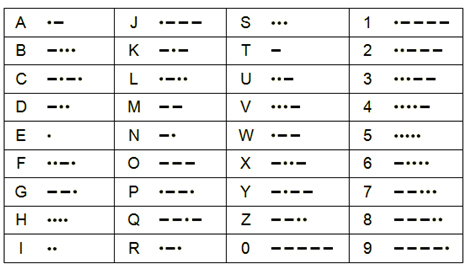

[← До розділу](Content.md) · [Зміст курсу](../README.md)

---

## Абетка Морзе
Написати програму, яка б переводила рядок англійською мовою в морзянку.

**Формат введення**  
Рядок, що складається з літер латинського алфавіту.  

**Формат виведення**  
Рядок, що відповідає коду Морзе вихідного рядка. Пробіл між словами замінити на 
знак `|:_..._:|`. Окремі символи розділити `|`.

**Таблиця кодування**  
  

**Приклади** 
```
Тест 1
Вхідні дані:
happy new year

Вивід програми:
....|.-|.--.|.--.|-.--||:_..._:|-.|.|.--||:_..._:|-.--|.|.-|.-.|
```

---

[← До розділу](Content.md) · [Зміст курсу](../README.md) · [← Попередній матеріал](%D0%A2%D0%B8%D0%BF_%D1%87%D0%B8%D1%81%D0%BB%D0%B0.md) · [Наступний матеріал →](%D0%94%D1%80%D0%B0%D0%B1%D0%B8%D0%BD%D0%BA%D0%B0.md)
