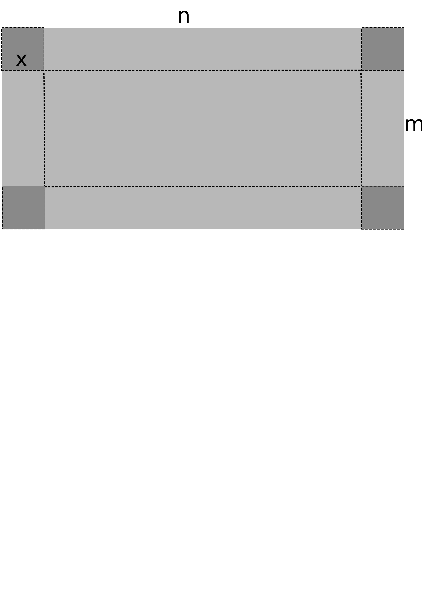

[← До розділу](Content.md) · [Зміст курсу](../README.md)

---

## Паралелепіпед максимального об'єму
Зварювальник Микола отримав замовлення зварити відкриту посудину у формі прямокутного 
паралелепіпеда з прямокутного листа металу розміру **n** x **m** метрів.  

***Технічне завдання замовника***:
1. У кожному куті листа металу вирізати одинакові квадрати з довжиною сторони **х** метрів (див. рисунок).
2. По лінії різу зігнути лист металу на кут 90 градусів з чотирьох сторін, утворивши таким 
чином борти посудини.
3. Зварити метал у місцях стикування бортів посудини.
4. Об'єм посудини повинен бути **максимальним**!

Допоможіть Миколі визначити розмір сторони квадрата **х**. Обчислення зробіть з точністю до
міліметрів. Напишіть рішення з використанням функції **maxVolume(length, width)**, де 
*length* та *width* розміри даного листа металу.

**Формат введення**  
Програма отримує на вхід два дійсних числа **n** та **m** (***0,2 < n, m < 3***) у рядок, розділені пробілом.

**Формат виведення**  
Виведіть одне число - відповідь на завдання.

**Приклади**
```
Тест 1
Вхідні дані:
2 1

Вивід програми:
0.211
```
[Демонстрація прикладу обчислень у табличному процесорі](https://docs.google.com/spreadsheets/d/1JjfD_ZNqUwI63Ea-xWlPV1Uoce1SvBelkV97mfcmMfo/edit?usp=sharing)  

***Рисунок***



---

[← До розділу](Content.md) · [Зміст курсу](../README.md) · [← Попередній матеріал](%D0%92%D0%B8%D0%BA%D0%BB%D1%8E%D1%87%D0%BD%D0%B5_%D0%90%D0%91%D0%9E.md) · [Наступний матеріал →](%D0%A0%D0%B5%D0%BA%D1%83%D1%81%D1%96%D1%8F_%D0%9E%D1%81%D0%BD%D0%BE%D0%B2%D0%BD%D1%96_%D0%BF%D0%BE%D0%BD%D1%8F%D1%82%D1%82%D1%8F.md)
