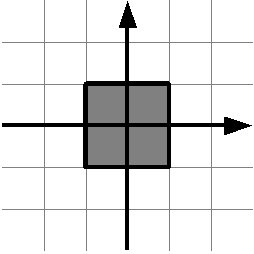

[← До розділу](Content.md) · [Зміст курсу](../README.md)

---

## Чи належить точка квадрату - 1
Дано два дійсних числа **x** та **y**. Перевірте, чи належить точка з координатами **(x, y)**
заштрихованому квадрату (включаючи його межу). Якщо точка належить квадрату, виведіть слово **YES**, 
інакше виведіть слово **NO**. На рисунку сітка побудована з кроком **1** (див. зображення).
Рішення має містити функцію **IsPointInSquare(x, y)**, яка повертає **True**, якщо точка належить
квадрату і **False**, якщо не належить. Основна програма повинна зчитувати координати точки, викликати
функцію **IsPointInSquare** та, в залежності від отриманого значення, вивести на екран необхідне 
повідомлення. Функція **IsPointInSquare** не повинна містити інструкцію **if**.

  

**Формат введення**  
Вводяться два дійсні числа.

**Формат виведення**  
Виведіть відповідь на завдання.

**Приклади**
```
Тест 1
Вхідні дані:
0
0
Вивід програми:
YES

Тест 2
Вхідні дані:
3
-7
Вивід програми:
NO

Тест 3
Вхідні дані:
0.5
0.5
Вивід програми:
YES
```

---

[← До розділу](Content.md) · [Зміст курсу](../README.md) · [← Попередній матеріал](%D0%9C%D1%96%D0%BD%D1%96%D0%BC%D1%83%D0%BC_4_%D1%87%D0%B8%D1%81%D0%B5%D0%BB.md) · [Наступний матеріал →](%D0%A7%D0%B8_%D0%BD%D0%B0%D0%BB%D0%B5%D0%B6%D0%B8%D1%82%D1%8C_%D1%82%D0%BE%D1%87%D0%BA%D0%B0_%D0%BA%D0%B2%D0%B0%D0%B4%D1%80%D0%B0%D1%82%D1%83_2.md)
